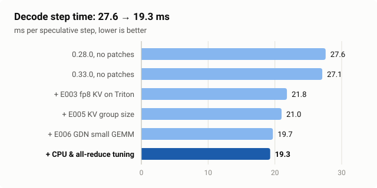
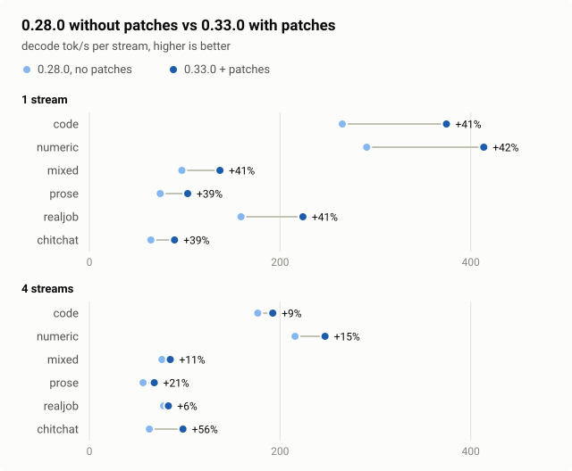

# vLLM hybrid Mamba / GDN field notes

Qwen3.8-27B-AWQ-INT4 (hybrid Gated DeltaNet) with a DFlash2 drafter on vLLM + LMCache,
2× RTX 3090, tensor parallel 2. What we run, what we measured, and what broke.
Last updated 2026-11-07.

The patches behind the current stack, with one card per patch and an agent guide for
porting them, are in
[llm-engine-qwen-optimization](https://github.com/uraniumchonk/llm-engine-qwen-optimization).
This repo holds the detailed numbers and the history.

## Current stack (since 2026-11-04)

```
vLLM 0.33.0 (torch 2.14 + CUDA 13)
  + E003  Triton reads fp8 KV on sm86, drafter on TRITON_ATTN   VLLM_TRITON_FP8_SW_DEQUANT=1
  + E005  hybrid KV group size 16                               VLLM_KV_GROUP_SIZE=16
  + E006  small-M GEMM for GDN in_proj_ba during spec decode    on when applied
  all-reduce: FlashInfer PCIe IPC                               VLLM_ALLREDUCE_USE_FLASHINFER_PCIE_IPC=1
LMCache 0.5.6 built from sdist against torch 2.14
  multiprocess server, --engine-type default --separate-object-groups --chunk-size 1600
  + E014  GDN / drafter state stored only at checkpoint chunks  LMCACHE_MEOW_CKPT_K=4
target   Qwen3.8-27B-AWQ-INT4, --attention-backend FLASHINFER, --kv-cache-dtype fp8
spec     DFlash2-W4A16-GPTQ, method=dflash, 7 speculative tokens, attention_backend=TRITON_ATTN
block-size 1600 / max-num-batched-tokens 2048 / max-num-seqs 4 / max-model-len 256k
gpu-memory-utilization 0.86 / prefix caching on / cudagraph_mode FULL_AND_PIECEWISE
GPU power limit 250 W
```

| Role | Repo |
|------|------|
| Target | [cyankiwi/Qwen3.8-27B-AWQ-INT4](https://huggingface.co/cyankiwi/Qwen3.8-27B-AWQ-INT4) |
| DFlash2 BF16 | [incoai/Qwen3.8-27B-DFlash2](https://huggingface.co/incoai/Qwen3.8-27B-DFlash2) |
| DFlash2 W4A16 GPTQ | Quantized from bf16 to W4A16 with our own chat text as calibration data, for acceptance rate. |

## Decode step time



Bars show the fastest run of each stage; the table has the range. Rows are cumulative.
"No patches" means none of our E-patches; the 0.28.0 row still has the upstream backports
#54165 and #50885. One step is one speculative round: the drafter proposes 7 tokens and
the target verifies them. Greedy sampling, 1 request, 300 tokens, LMCache off, on a test
instance; code, prose and mixed prompts, 2 reps each.

| Stage | ms per step | Date |
|---|---|---|
| vLLM 0.28.0 + backports, drafter on FlashInfer | 27.6–31.0 | 2026-11-03 |
| vLLM 0.33.0 unpatched | 27.10–27.47 | 2026-11-03 |
| + E003 | 21.77–22.10 | 2026-11-03 |
| + E005 | 21.0–21.3 | 2026-11-03 |
| + E006a/b/c | 19.74–19.91 | 2026-11-04 |
| + CPU governor `performance` | 19.58–19.71 | 2026-11-04 |
| + FlashInfer PCIe IPC all-reduce (current) | 19.28–19.42 | 2026-11-04 |
| for reference: vLLM 0.33.0 without speculative decoding | 14.23–14.31 | 2026-11-03 |

The step without speculation is shorter but yields one token per step.

## Tokens per second: 0.28.0 without patches vs 0.33.0 with patches



Decode tok/s per stream, typev2 suite, 256 max tokens, temperature 0, through the
production front end with LMCache on.

- 0.28.0, no patches: the 2026-08-28 stack, measured 2026-09-11, mean of 3 runs (range in
  brackets).
- 0.33.0 + patches: E003/E005/E006 + LMCache 0.5.6 + E014, measured 2026-11-04, 1 run,
  before the PCIe IPC switch.

| Type | Streams | 0.28.0, no patches (range) | 0.33.0 + patches | Change |
|---|---|---|---|---|
| code | 1 | 265.3 (259.6–268.7) | 374.5 | +41% |
| code | 4 | 176.6 (173.5–180.0) | 192.4 | +9% |
| numeric | 1 | 290.9 (285.2–293.8) | 413.7 | +42% |
| numeric | 4 | 215.7 (213.8–218.0) | 247.2 | +15% |
| mixed | 1 | 97.0 (93.1–101.6) | 137.0 | +41% |
| mixed | 4 | 76.1 (73.2–79.3) | 84.8 | +11% |
| prose | 1 | 74.3 (66.0–79.7) | 103.1 | +39% |
| prose | 4 | 56.3 (54.7–57.3) | 68.1 | +21% |
| realjob | 1 | 159.1 (142.9–167.6) | 224.0 | +41% |
| realjob | 4 | 77.9 (72.9–85.1) | 82.9 | +6% |
| chitchat | 1 | 64.5 (59.3–67.4) | 89.3 | +39% |
| chitchat | 4 | 62.9 (50.1–88.0) | 98.2 | +56% |

- realjob and chitchat resend the same conversation history (no anti-cache nonce), as
  the 2026-09-11 runner did, so the whole prompt can hit the prefix cache.
- 2026-11-04: inter-token latency p50 19.4–20.3 ms at 1 stream, 29.9–32.2 ms at 4 streams;
  draft acceptance 3,911 / 12,397 = 0.315.
- Setting differences on 2026-09-11: gpu-memory-utilization 0.88, max-num-seqs 6,
  `--mamba-cache-mode align`. Both dates ran at 250 W. The three 2026-09-11 runs differ by
  about ±3%.
- Production sampling (temperature 0.7, top_p 0.88, top_k 20), 300 tokens, 1 request:
  vLLM 0.28.0 on 2026-11-03 code 207.5–209.3, prose 50.4–52.4, mixed 98.2–102.3 tok/s;
  vLLM 0.33.0 + patches on 2026-11-04 code 266.9–284.2, prose 69.0–72.1, mixed
  143.0–144.2 tok/s.

## When speculative decoding loses

vLLM 0.33.0 on 2026-11-03, prose prompts, before E006c: 1 stream 73.7 tok/s with DFlash2
vs 70.4 without; 4 streams 168.5 tok/s with DFlash2 vs 240.8 without (aggregate).

## LMCache on the current stack

Measured 2026-11-04 on a test server with the production flags; requests reset the vLLM
prefix cache first, so cached tokens come only from LMCache.

| | single object group (blend) | `--separate-object-groups` |
|---|---|---|
| 71,899-token prompt, L1 hit (70,400 cached) | 3.02 s | 2.15 s |
| same prompt, cold prefill | 48.6 s | 48.6 s |
| L2 prefetch of that prompt after a server restart | 1,132.6 ms (88 keys) | 409.8 ms (94 keys) |
| L2 bytes per 1,600-token chunk per rank | 77,414,400 | 26,214,400 attention + 43,008,000 GDN + 8,192,000 drafter |

- With E014 (K=4) the GDN and drafter objects are stored only at checkpoint chunks: on our
  test workload L2 bytes −43%, one 25k-token production request −46%. Details on the
  [E014 card](https://github.com/uraniumchonk/llm-engine-qwen-optimization/blob/main/qwen3.8-27b/lmcache/v0.5.6/README.md).
- GPU checksums of every chunk on store and retrieve matched (0 mismatches) for all three
  object groups.

## Traps on this stack

- The LMCache 0.5.6 PyPI wheel's `lmcache.cuda_ops` is built for torch 2.13. Under torch
  2.14 it fails to import and LMCache falls back to plain torch copies. Build 0.5.6 from
  the sdist against your torch.
- LMCache 0.5.6 cannot combine blend mode with `--separate-object-groups`. GDN hybrids need
  separate object groups.
- A different KV group layout (for example `VLLM_KV_GROUP_SIZE`) changes what LMCache
  stores. Point it at a fresh L2 directory.
- vLLM 0.33's torch.compile AOT cache keys on source, not on environment variables. A
  switch read at trace time stays frozen in a cached graph; read switches at run time.
- nsys node-level tracing stretched a 27.6 ms step to 35.7 ms on vLLM 0.28.0. Trust its
  kernel times; take step wall time from runs without the profiler.
- Other processes using the CPU add 2–3 ms per step. Check `uptime` and `top` before
  measuring.
- The same code tree with the same compile cache gives bit-identical greedy logits across
  restarts. A new tree or a fresh cache on the same code path gives a top-20 KL near
  4.5e-4, so compare patches against that floor.

## History

Older stacks, kept for anyone on those versions. Pointers only; the full detail is in
the linked files.

| Date | Stack | Where |
|---|---|---|
| 2026-11-04 → | vLLM 0.33.0 + E003/E005/E006, LMCache 0.5.6 + E014, TP2 | this README |
| 2026-09-16 | INT8 W8A16 on 4× RTX 3090 TP4, DFlash2-W8, 262K context; NCCL symmetric-memory A/B | [INT8 TP4 suite](reports/qwen38_int8_tp4_suite_20260916.html) ([preview](https://htmlpreview.github.io/?https://raw.githubusercontent.com/uraniumchonk/vllm-hybrid-mamba-notes/main/reports/qwen38_int8_tp4_suite_20260916.html)), [4-card 3-model comparison](reports/4card_3model_20260916.html), [symm-mem A/B](reports/symm_ab_20260916.md) |
| 2026-09-11 | PCIe P2P vs host staging: +22% decode on 2× RTX 3090 TP2 | [report](reports/gpu_p2p_vs_host_staging_20260911.html) ([preview](https://htmlpreview.github.io/?https://raw.githubusercontent.com/uraniumchonk/vllm-hybrid-mamba-notes/main/reports/gpu_p2p_vs_host_staging_20260911.html)), [FIELD_NOTES §11](FIELD_NOTES.md#11-pcie-p2p-vs-host-staging-smh--measured-22-decode-2026-09-11) |
| 2026-08-28 | vLLM 0.28.0 + #54165 + #50885 + `_dense_kv_rows()`, LMCache 0.5.4rc5, DFlash2 K=7 | [report](reports/qwen38_0280_dflash2_lmcache_20260828.html) ([preview](https://htmlpreview.github.io/?https://raw.githubusercontent.com/uraniumchonk/vllm-hybrid-mamba-notes/main/reports/qwen38_0280_dflash2_lmcache_20260828.html)), section below |
| 2026-08-19 | vLLM 0.27.1, drafter comparison (DFlash2, DSpark, MTP) | [report](reports/qwen38_int4_spec_drafter_compare_20260819.html) ([preview](https://htmlpreview.github.io/?https://raw.githubusercontent.com/uraniumchonk/vllm-hybrid-mamba-notes/main/reports/qwen38_int4_spec_drafter_compare_20260819.html)) |
| 2026-08-18 | FP8 on RTX 3090 and RTX 3080 | [3090](reports/qwen38_fp8_forum_post_3090_20260818.html) ([preview](https://htmlpreview.github.io/?https://raw.githubusercontent.com/uraniumchonk/vllm-hybrid-mamba-notes/main/reports/qwen38_fp8_forum_post_3090_20260818.html)), [3080](reports/qwen38_fp8_forum_post.html) ([preview](https://htmlpreview.github.io/?https://raw.githubusercontent.com/uraniumchonk/vllm-hybrid-mamba-notes/main/reports/qwen38_fp8_forum_post.html)) |
| 2026-08 and earlier | vLLM 0.25–0.28: MTP + prefix cache + LMCache failure modes, compatibility matrix, symptom lookup, upstream index | [FIELD_NOTES.md](FIELD_NOTES.md) |

### The vLLM 0.28.0 TP2 stack (2026-08-28)

```
vLLM 0.28.0
  + #54165 (DFlash is not EAGLE for mamba last-block)
  + #50885 (FlashInfer native FULL decode CUDA graphs)
  + _dense_kv_rows() for packed W4/W8 drafts
LMCache 0.5.4rc5  LMCacheMPConnector kv_both
prefix cache ON
spec = DFlash2-W4A16-GPTQ  method=dflash  K=7
mamba-cache-mode=align
block-size 1600 / chunk-size 1600 / max-num-batched-tokens 2048
gpu-memory-utilization 0.94
```

n=1 decode tok/s on 2026-08-28, same INT4 target, 2× RTX 3090:

| type | no DFlash | DFlash2 W4A16 K=7 | |
|------|-----------|----------------|--|
| code | 71 | **268** | 3.8× |
| realjob | ~70 | **165** | 2.4× |
| mixed | 70 | **97** | 1.4× |
| prose | 70 | 76 | 1.1× |

Do not run stock 0.28.0 with LMCache + DFlash. Do not pass `--kv-offloading-*` next to
LMCacheMPConnector.

| vLLM | LMCache | Spec | Result |
|------|---------|------|--------|
| 0.28.0 + #54165 + #50885 | 0.5.4rc5 | DFlash2 K=7 | worked (2026-08-28) |
| 0.28.0 stock | on | DFlash2 | #53505 retrieve salad |
| 0.28.0 stock | off | DFlash2 | PIECEWISE; code/mixed slow |
| 0.27.1 | off | DFlash2 | daily driver before 2026-08-28 (no retrieve) |
| 0.25.1 | 0.5.1 | off | daily driver without spec |

DSpark drafter: [RadixArk/Qwen3.8-27B-DSpark](https://huggingface.co/RadixArk/Qwen3.8-27B-DSpark) (2026-08-19 comparison).
