# vLLM hybrid Mamba / GDN field notes

Qwen3.8-27B-AWQ-INT4 (hybrid Gated DeltaNet) with a DFlash2 drafter on vLLM + LMCache,
2× RTX 3090, tensor parallel 2. What we run, what we measured, and what broke.
Last updated 2026-11-28.

The patches behind the current stack, with one card per patch and an agent guide for
porting them, are in
[llm-engine-qwen-optimization](https://github.com/uraniumchonk/llm-engine-qwen-optimization).
This repo holds the detailed numbers and the history.

## Current stack (patch set v2, since 2026-11-28)

```
vLLM 0.33.0 (torch 2.14 + CUDA 13)
  + E003  Triton reads fp8 KV on sm86, drafter on TRITON_ATTN   VLLM_TRITON_FP8_SW_DEQUANT=1
  + E005  hybrid KV group size 16                               VLLM_KV_GROUP_SIZE=16
  + E006  small-M GEMM for GDN in_proj_ba during spec decode    on when applied
  + E031  64-token prefix-cache hits + CoW block-copy fix       VLLM_E031_SWA_FINE_HITS=1
  patch set v2 adds, 2026-11-28:
  + E042  drafter sliding-window attention on Triton's 3D path  VLLM_TRITON_SWA_3D=1
  + E043  small-M GEMM in one wave with a fused reduce          VLLM_E006_FAST=1
  + E044  NVFP4 copy of the lm_head for the drafter             VLLM_DFLASH_LM_HEAD_QUANT=nvfp4
  + E045  draft tokens by local argmax on each TP rank          VLLM_DFLASH_LOCAL_ARGMAX=1
  + E046  text-only steps skip the multimodal embedding merge   VLLM_FAST_TEXT_EMBEDS=1
  + E047  short prefill steps run GDN on one recurrent kernel   VLLM_GDN_SHORT_PREFILL_MAX=256
  + E052  target attention plan without the per-step GPU wait   VLLM_E052_PLAN_NO_WAIT=1
  + E053  whole-column Marlin launch for small batches          VLLM_MEOW_MARLIN_WC=1, VLLM_MEOW_MARLIN_LIB=<meow_wc.so>
  upstream switches:
  GDN decode kernel: Triton                                     VLLM_GDN_DECODE_KERNEL=triton
  all-reduce: FlashInfer PCIe IPC                               VLLM_ALLREDUCE_USE_FLASHINFER_PCIE_IPC=1
  fastokens 0.2.1                                               VLLM_USE_FASTOKENS=1
LMCache 0.5.6 built from sdist against torch 2.14
  multiprocess server, --engine-type default --separate-object-groups --chunk-size 1600
  + E014  GDN / drafter state stored only at checkpoint chunks  LMCACHE_MEOW_CKPT_K=4
  + E030  L2 index kept in step with the files on disk          LMCACHE_MEOW_L2_SYNC=1
  + E033  local-skip lookup + lookup wait budget                LMCACHE_MEOW_LOCAL_SKIP=1, LMCACHE_MEOW_LOOKUP_WAIT_MS=5
  + E034  synchronous L1 eviction with reserve fallback         LMCACHE_MEOW_SYNC_EVICT=1, LMCACHE_MEOW_RESERVE_FALLBACK=1
target   Qwen3.8-27B-AWQ-INT4, --attention-backend FLASHINFER, --kv-cache-dtype fp8
spec     DFlash2-W4A16-GPTQ, method=dflash, 7 speculative tokens, attention_backend=TRITON_ATTN
block-size 1600 / max-num-batched-tokens 2048 / max-num-seqs 4 / max-model-len 256k
gpu-memory-utilization 0.86 / prefix caching on / --prefix-match-unit 64 (E031, since 2026-11-13)
cudagraph_mode FULL_AND_PIECEWISE
GPU0/1 power limit 300 W, CPU Ryzen 9 5900X
(every measurement dated before 2026-11-17: 250 W and a Ryzen 5 5600)
```

The ten switches added for v2 are the E042–E053 lines above (E053 is two variables) plus
`VLLM_GDN_DECODE_KERNEL=triton`. PCIe IPC all-reduce was already a live flag on 2026-11-28.

| Role | Repo |
|------|------|
| Target | [cyankiwi/Qwen3.8-27B-AWQ-INT4](https://huggingface.co/cyankiwi/Qwen3.8-27B-AWQ-INT4) |
| DFlash2 BF16 | [incoai/Qwen3.8-27B-DFlash2](https://huggingface.co/incoai/Qwen3.8-27B-DFlash2) |
| DFlash2 W4A16 GPTQ | Quantized from bf16 to W4A16 with our own chat text as calibration data, for acceptance rate. |

## Setups compared

**All charts in this section were measured without our engine patches** (E003, E005, E006,
E014); every run predates them.

2026-11-28: these INT4/INT8, TP4, and P2P charts were not re-run. The same day, on the
current hardware (Ryzen 9 5900X, GPU0/1 at a 300 W limit), the unpatched vLLM 0.33.0 wheel
was compared with patch set v2. That comparison is in the appendix below.

Qwen3.8-27B on different combinations of quantization, GPU count, PCIe P2P and drafter.
The charts leave out numeric, a ceiling at about 100% draft acceptance. Output types are
defined in the [typev2 method](https://github.com/uraniumchonk/llm-engine-qwen-optimization/blob/main/skills/measurement/references/typev2-method.md).
Full tables are in the reports under [History](#history).

### INT4 vs INT8, TP2 vs TP4

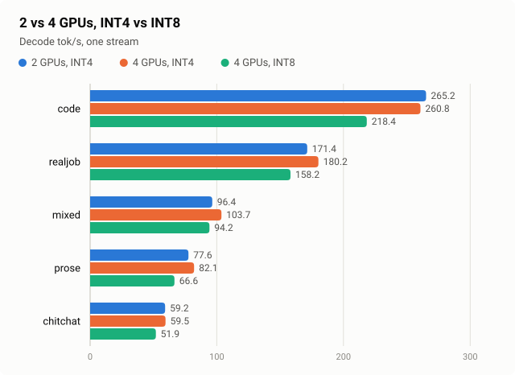

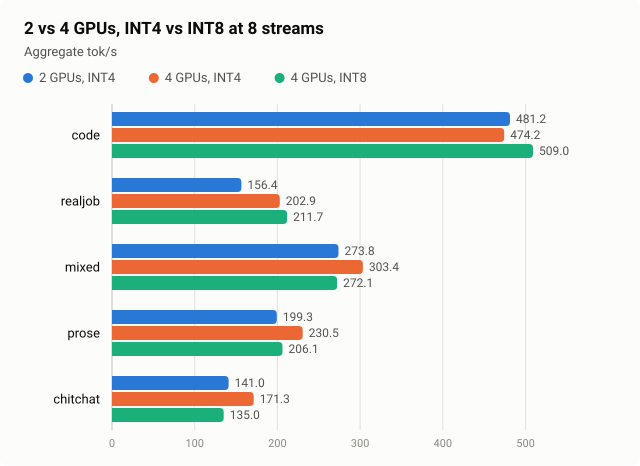

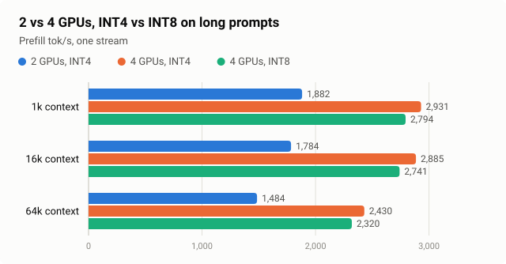

vLLM 0.28.0, same machine, 2026-09-16, one run per bar, 256 max tokens, temperature 0.
2 GPUs is TP2 and 4 GPUs is TP4. INT4 is AWQ-INT4 with DFlash2 K=7; INT8 is W8A16 with
DFlash2-W8 K=7. Three runs of the two-GPU stack on 2026-09-11 differed by about ±3%.

### PCIe P2P

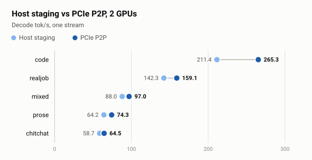

vLLM 0.28.0, AWQ-INT4, DFlash2-W4A16-GPTQ K=7, typev2, 2× RTX 3090 on a PCIe switch without
NVLink, 2026-09-11. Means of 2 runs (host staging) and 3 runs (P2P). The realjob ranges
overlap: 140.9–143.7 and 142.9–167.6 tok/s. Inter-token latency p99, averaged across
configurations: 103.5 → 76.5 ms.

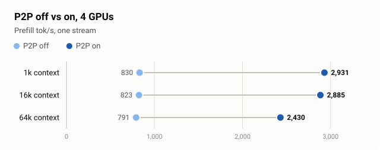

vLLM 0.28.0, AWQ-INT4, DFlash2 K=7, TP4 on 4× RTX 3090, 2026-09-16, one run per point. P2P
off is `NCCL_P2P_DISABLE=1` with no custom all-reduce. Decode averaged over the six types
was 164.4 tok/s with P2P on and 103.8 tok/s with it off.

### Drafters

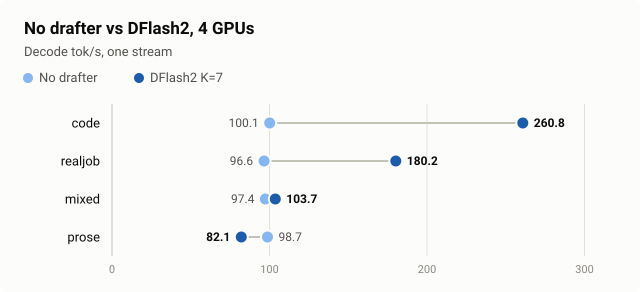

AWQ-INT4 on 4× RTX 3090, vLLM 0.28.0, 2026-09-16, one run per point. The drafter is slower
on prose. The no-drafter run has no chitchat result.

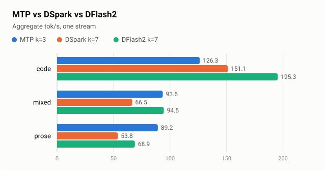

AWQ-INT4 target, 2× RTX 3090, same prompts, no LMCache. DFlash2 on vLLM 0.27.1
(2026-08-19), DSpark on 0.27.1 (2026-08-18), MTP on 0.25.1 (2026-08-19). We turned MTP off
on 2026-08-19 after output corruption when agents switched
([field notes](FIELD_NOTES.md)).

## When speculative decoding loses

vLLM 0.33.0 on 2026-11-03, prose prompts, before E006c: 1 stream 73.7 tok/s with DFlash2
vs 70.4 without; 4 streams 168.5 tok/s with DFlash2 vs 240.8 without (aggregate).

## LMCache on the current stack

2026-11-28: the rows below were measured on 2026-11-04, before E030, E033, E034, and before
patch set v2. LMCache in v2 is still 0.5.6 with E014, E030, E033, and E034. kv_probe was
not run on v2.

Measured 2026-11-04 on a test server with the production flags; requests reset the vLLM
prefix cache first, so cached tokens come only from LMCache.

| | single object group (blend) | `--separate-object-groups` |
|---|---|---|
| 71,899-token prompt, L1 hit (70,400 cached) | 3.02 s | 2.15 s |
| same prompt, cold prefill | 48.6 s | 48.6 s |
| L2 prefetch of that prompt after a server restart | 1,132.6 ms (88 keys) | 409.8 ms (94 keys) |
| L2 bytes per 1,600-token chunk per rank | 77,414,400 | 26,214,400 attention + 43,008,000 GDN + 8,192,000 drafter |

- With E014 (K=4) the GDN and drafter objects are stored only at checkpoint chunks: on our
  test workload L2 bytes −43%, one 25k-token production request −46%. Details on the
  [E014 card](https://github.com/uraniumchonk/llm-engine-qwen-optimization/blob/main/qwen3.8-27b/lmcache/v0.5.6/README.md).
- GPU checksums of every chunk on store and retrieve matched (0 mismatches) for all three
  object groups.

## Traps on this stack

- The LMCache 0.5.6 PyPI wheel's `lmcache.cuda_ops` is built for torch 2.13. Under torch
  2.14 it fails to import and LMCache falls back to plain torch copies. Build 0.5.6 from
  the sdist against your torch.
- LMCache 0.5.6 cannot combine blend mode with `--separate-object-groups`. GDN hybrids need
  separate object groups.
- A different KV group layout (for example `VLLM_KV_GROUP_SIZE`) changes what LMCache
  stores. Point it at a fresh L2 directory.
- vLLM 0.33's torch.compile AOT cache keys on source, not on environment variables. A
  switch read at trace time stays frozen in a cached graph; read switches at run time.
- nsys node-level tracing stretched a 27.6 ms step to 35.7 ms on vLLM 0.28.0. Trust its
  kernel times; take step wall time from runs without the profiler.
- Other processes using the CPU add 2–3 ms per step. Check `uptime` and `top` before
  measuring.
- The same code tree with the same compile cache gives bit-identical greedy logits across
  restarts. A new tree or a fresh cache on the same code path gives a top-20 KL near
  4.5e-4, so compare patches against that floor.
- 2026-11-28: the same v1 build on the live instance and on the test instance was not
  bitwise identical (973 greedy tokens, top-1 agreement 99.38%, KL 4.52e-4, step 18.08 ms
  vs 18.27 ms). Cause not examined. Compare two versions on one kind of instance.

## History

Older stacks, kept for anyone on those versions. Pointers only; the full detail is in
the linked files.

| Date | Stack | Where |
|---|---|---|
| 2026-11-28 → | vLLM 0.33.0 patch set v2 (v1 plus E042–E047, E052, E053) and the ten switches, LMCache 0.5.6 + E014/E030/E033/E034, TP2 | this README, Current stack |
| 2026-11-14 → 2026-11-28 | vLLM 0.33.0 + E003/E005/E006/E031, LMCache 0.5.6 + E014/E030/E033/E034, TP2 | this README |
| 2026-11-04 → 2026-11-13 | vLLM 0.33.0 + E003/E005/E006, LMCache 0.5.6 + E014, TP2 | [patch cards](https://github.com/uraniumchonk/llm-engine-qwen-optimization) |
| 2026-09-16 | INT8 W8A16 on 4× RTX 3090 TP4, DFlash2-W8, 262K context; NCCL symmetric-memory A/B | [INT8 TP4 suite](reports/qwen38_int8_tp4_suite_20260916.html) ([preview](https://htmlpreview.github.io/?https://raw.githubusercontent.com/uraniumchonk/vllm-hybrid-mamba-notes/main/reports/qwen38_int8_tp4_suite_20260916.html)), [4-card 3-model comparison](reports/4card_3model_20260916.html), [symm-mem A/B](reports/symm_ab_20260916.md) |
| 2026-09-11 | PCIe P2P vs host staging: +22% decode on 2× RTX 3090 TP2 | [report](reports/gpu_p2p_vs_host_staging_20260911.html) ([preview](https://htmlpreview.github.io/?https://raw.githubusercontent.com/uraniumchonk/vllm-hybrid-mamba-notes/main/reports/gpu_p2p_vs_host_staging_20260911.html)), [FIELD_NOTES §11](FIELD_NOTES.md#11-pcie-p2p-vs-host-staging-smh--measured-22-decode-2026-09-11) |
| 2026-08-28 | vLLM 0.28.0 + #54165 + #50885 + `_dense_kv_rows()`, LMCache 0.5.4rc5, DFlash2 K=7 | [report](reports/qwen38_0280_dflash2_lmcache_20260828.html) ([preview](https://htmlpreview.github.io/?https://raw.githubusercontent.com/uraniumchonk/vllm-hybrid-mamba-notes/main/reports/qwen38_0280_dflash2_lmcache_20260828.html)), section below |
| 2026-08-19 | vLLM 0.27.1, drafter comparison (DFlash2, DSpark, MTP) | [report](reports/qwen38_int4_spec_drafter_compare_20260819.html) ([preview](https://htmlpreview.github.io/?https://raw.githubusercontent.com/uraniumchonk/vllm-hybrid-mamba-notes/main/reports/qwen38_int4_spec_drafter_compare_20260819.html)) |
| 2026-08-18 | FP8 on RTX 3090 and RTX 3080 | [3090](reports/qwen38_fp8_forum_post_3090_20260818.html) ([preview](https://htmlpreview.github.io/?https://raw.githubusercontent.com/uraniumchonk/vllm-hybrid-mamba-notes/main/reports/qwen38_fp8_forum_post_3090_20260818.html)), [3080](reports/qwen38_fp8_forum_post.html) ([preview](https://htmlpreview.github.io/?https://raw.githubusercontent.com/uraniumchonk/vllm-hybrid-mamba-notes/main/reports/qwen38_fp8_forum_post.html)) |
| 2026-08 and earlier | vLLM 0.25–0.28: MTP + prefix cache + LMCache failure modes, compatibility matrix, symptom lookup, upstream index | [FIELD_NOTES.md](FIELD_NOTES.md) |

### The vLLM 0.28.0 TP2 stack (2026-08-28)

```
vLLM 0.28.0
  + #54165 (DFlash is not EAGLE for mamba last-block)
  + #50885 (FlashInfer native FULL decode CUDA graphs)
  + _dense_kv_rows() for packed W4/W8 drafts
LMCache 0.5.4rc5  LMCacheMPConnector kv_both
prefix cache ON
spec = DFlash2-W4A16-GPTQ  method=dflash  K=7
mamba-cache-mode=align
block-size 1600 / chunk-size 1600 / max-num-batched-tokens 2048
gpu-memory-utilization 0.94
```

n=1 decode tok/s on 2026-08-28, same INT4 target, 2× RTX 3090:

| type | no DFlash | DFlash2 W4A16 K=7 | |
|------|-----------|----------------|--|
| code | 71 | **268** | 3.8× |
| realjob | ~70 | **165** | 2.4× |
| mixed | 70 | **97** | 1.4× |
| prose | 70 | 76 | 1.1× |

Do not run stock 0.28.0 with LMCache + DFlash. Do not pass `--kv-offloading-*` next to
LMCacheMPConnector.

| vLLM | LMCache | Spec | Result |
|------|---------|------|--------|
| 0.28.0 + #54165 + #50885 | 0.5.4rc5 | DFlash2 K=7 | worked (2026-08-28) |
| 0.28.0 stock | on | DFlash2 | #53505 retrieve salad |
| 0.28.0 stock | off | DFlash2 | PIECEWISE; code/mixed slow |
| 0.27.1 | off | DFlash2 | daily driver before 2026-08-28 (no retrieve) |
| 0.25.1 | 0.5.1 | off | daily driver without spec |

DSpark drafter: [RadixArk/Qwen3.8-27B-DSpark](https://huggingface.co/RadixArk/Qwen3.8-27B-DSpark) (2026-08-19 comparison).

## Appendix: engine patches

Results of the patches in [llm-engine-qwen-optimization](https://github.com/uraniumchonk/llm-engine-qwen-optimization).

### Decode step time

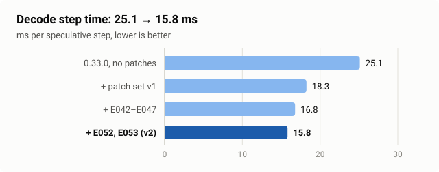

Bars show the fastest run of each stage; the table has the range. Rows are cumulative.
One step is one speculative round: the drafter proposes 7 tokens and the target verifies
them. Greedy sampling, 1 request, 300 tokens, LMCache off, on a test instance; code, prose
and mixed prompts, 2 reps each. All rows measured 2026-11-28 on the current hardware
(Ryzen 9 5900X, both GPUs at a 300 W limit, CPU governor `schedutil`).

| Stage | ms per step | Runs |
|---|---|---|
| vLLM 0.33.0, no patches, upstream defaults (drafter attention on FlashInfer) | 25.11–26.03 | 6 |
| + patch set v1: E003, E005, E006a/b/c, E031, FlashInfer PCIe IPC all-reduce | 18.25–18.29 | 6 |
| + E042–E047 and upstream's Triton GDN decode kernel | 16.78–16.89 | 3 |
| + E052, E053 = patch set v2 (current) | 15.81–15.84 | 6 |

Each range is the minimum and maximum wall step time of those runs. The chart's 25.1 ms
and 15.8 ms are the fastest run of the first and last rows, shown to 0.1 ms. The
median of the six runs is 25.42 ms unpatched, 18.27 ms for v1, and 15.83 ms
for v2. v1's repeat arm in the same window was 18.25–18.31 ms, median 18.27 ms.

The third row comes from an earlier window of the same day, in which v1 read 18.33–18.36
and v2 15.80–15.82 ms.

With a long context (one decode request per context, same day), ms per step:

| Context | No patches | v1 | v2 |
|---|---|---|---|
| 16K | 26.01 | 19.47 | 16.56 |
| 64K | 27.92 | 20.98 | 18.09 |
| 128K | 29.11 | 22.95 | 20.10 |

What v2 costs, what it leaves unchanged, and what is open:

- Output is not bitwise identical to v1: top-20 decode logit KL 4.71e-4 over 1,125 greedy
  tokens (top-1 agreement 99.56%, test instance) and 4.42e-4 over 915 tokens (99.45%, live
  instance). The same tree with a fresh compile cache reads about 4.5e-4.
- KV pool: 393,229 tokens without patches, 486,666 with v1, 466,666 with v2 (20,000 below
  v1). E044's own A/B read 489,333 → 470,666 (−18,667); the other switches were not split out.
- Prefill is unchanged: cold prefill at 16K / 64K / 128K runs at 2,748 / 2,166 / 1,888
  tokens per second without patches and 2,764 / 2,174 / 1,885 with v2.
- First token after a prefix hit, 50 new tokens on a 16K / 64K / 128K context: 166 / 940 /
  562 ms without patches (hits end on a 1,600-token block, so 262 / 1,469 / 408 tokens are
  computed again), 127 / 114 / 223 ms with v1, 83 / 106 / 197 ms with v2.
- Open: 4 requests of 62K tokens asked twice, LMCache off. In the second round the engine
  without patches and v1 served all four from the prefix cache (decode wall 2.97 s and
  2.46 s); v2 computed one of the four again in the one run we have (decode wall 28.3 s).
  Cause not examined. With a test LMCache attached, v2's second round took 2.20 s.
- Open: 4 concurrent cold prompts of 1K to 16K tokens, test instance, LMCache off. Mean
  prefill tok/s at 4K is 1,483.1 without patches and 1,218.1 with v2. The p99
  first-token time of the four requests in that cell is 5.836 s and 5.785 s. The run record also places v1 at
  1,219 beside those two. The 4K × 4 v1 reading on the live instance, LMCache on, is
  1,218.9 tok/s, a different instance from the pair above. Cause not examined.
- E041 is not in v2. kv_probe was not run on v2. More than 4 concurrent requests and
  preemption were not measured.
- 2026-11-28 method: one test instance, LMCache off, frozen prompts, quiet machine. A
  4-request short-prompt step time is four copies of one prompt. Mixed
  prompts are a batch tok/s, not an engine step. The long-context 4-request cold wall
  mixes later prefills into the clock and is not a decode step. Unit groups E042, E043,
  E044, E047, E052, and E053 passed on the v2 tree (6 of 6).

#### Earlier: 2026-11-03/04 on the previous hardware

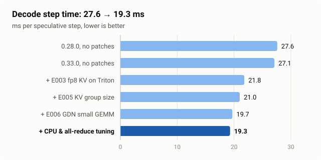

Measured with a Ryzen 5 5600 and both GPUs at a 250 W limit. The same unpatched 0.33.0 read
27.10–27.47 ms then and 25.11–26.03 ms on 2026-11-28.
Bars show the fastest run of each stage; the table has the range. Rows are cumulative.
"No patches" means none of our E-patches; the 0.28.0 row still has the upstream backports
#54165 and #50885. One step is one speculative round: the drafter proposes 7 tokens and
the target verifies them. Greedy sampling, 1 request, 300 tokens, LMCache off, on a test
instance; code, prose and mixed prompts, 2 reps each.

| Stage | ms per step | Date |
|---|---|---|
| vLLM 0.28.0 + backports, drafter on FlashInfer | 27.6–31.0 | 2026-11-03 |
| vLLM 0.33.0 unpatched | 27.10–27.47 | 2026-11-03 |
| + E003 | 21.77–22.10 | 2026-11-03 |
| + E005 | 21.0–21.3 | 2026-11-03 |
| + E006a/b/c | 19.74–19.91 | 2026-11-04 |
| + CPU governor `performance` | 19.58–19.71 | 2026-11-04 |
| + FlashInfer PCIe IPC all-reduce (the 2026-11-04 production set) | 19.28–19.42 | 2026-11-04 |
| for reference: vLLM 0.33.0 without speculative decoding | 14.23–14.31 | 2026-11-03 |

The step without speculation is shorter but yields one token per step.

### Tokens per second: 0.33.0 without patches vs 0.33.0 with patches

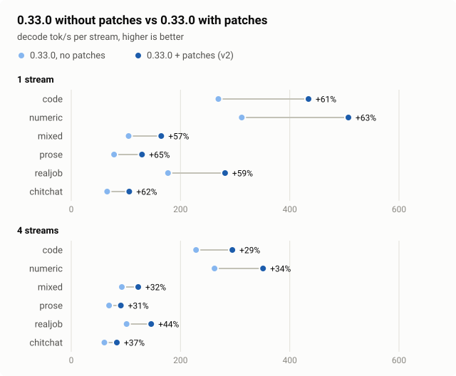

Decode tok/s per stream, typev2 suite, 256 max tokens, temperature 0, sent straight to a
test instance with LMCache off. Both sides measured 2026-11-28 on the same hardware, 2
repeats each; the table has the mean and the two readings.

How the suite is built and read: [typev2 method](https://github.com/uraniumchonk/llm-engine-qwen-optimization/blob/main/skills/measurement/references/typev2-method.md).
numeric is a ceiling at about 100% draft acceptance. realjob and chitchat use our private
records and a drafter calibrated on our traffic, so build your own corpus to compare.

| Type | Streams | 0.33.0, no patches (readings) | 0.33.0 + patches v2 (readings) | Change |
|---|---|---|---|---|
| code | 1 | 269.4 (257.3, 281.4) | 434.4 (410.6, 458.1) | +61% |
| code | 4 | 228.6 (226.7, 230.4) | 294.9 (290.2, 299.5) | +29% |
| numeric | 1 | 312.1 (307.7, 316.6) | 507.4 (507.2, 507.6) | +63% |
| numeric | 4 | 262.3 (261.3, 263.3) | 351.1 (348.1, 354.2) | +34% |
| mixed | 1 | 105.1 (102.7, 107.4) | 164.7 (163.0, 166.4) | +57% |
| mixed | 4 | 92.7 (91.8, 93.5) | 122.5 (121.1, 124.0) | +32% |
| prose | 1 | 78.3 (72.1, 84.6) | 129.6 (126.8, 132.3) | +65% |
| prose | 4 | 69.2 (68.7, 69.8) | 90.8 (89.7, 91.8) | +31% |
| realjob | 1 | 177.2 (175.4, 178.9) | 281.6 (281.5, 281.6) | +59% |
| realjob | 4 | 101.3 (87.0, 115.6) | 146.3 (118.3, 174.3) | +44% |
| chitchat | 1 | 65.8 (61.3, 70.2) | 106.2 (99.2, 113.2) | +62% |
| chitchat | 4 | 60.7 (59.0, 62.4) | 83.5 (82.0, 84.9) | +37% |

- "No patches" is the PyPI wheel with upstream defaults: drafter attention on FlashInfer,
  prefix hits on whole 1,600-token blocks, no PCIe IPC all-reduce, no fastokens.
- The percent column and the chart labels are decode tok/s per stream. +29–44% at 4 streams
  is that per-stream range. +18–41% below is aggregate tok/s of the whole 4-stream batch.
- The two realjob readings at 4 streams are far apart on both sides.
- Tokens per second of the whole 4-stream batch, time to first token included: numeric
  847 → 1,088, code 571 → 670, prose 214 → 286, mixed 324 → 420, realjob 187 → 252,
  chitchat 144 → 203 (+18% to +41%).
- v1 → v2 through the production front end with LMCache on, 1 stream, same day: numeric
  440.5 → 506.1, code 360.5 → 441.4, mixed 153.6 → 174.6, prose 115.3 → 121.6, realjob
  242.4 → 281.2, chitchat 84.3 → 110.0.

#### Earlier: 0.28.0 without patches vs 0.33.0 with patches (2026-11-04, previous hardware)

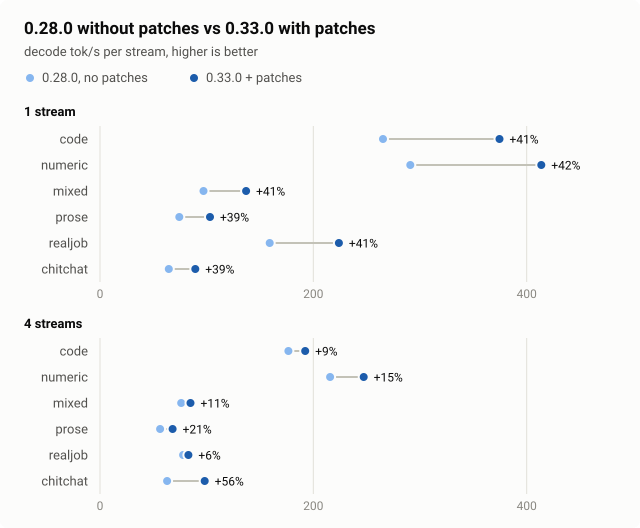

Decode tok/s per stream, typev2 suite, 256 max tokens, temperature 0, through the
production front end with LMCache on.

How the suite is built and read: [typev2 method](https://github.com/uraniumchonk/llm-engine-qwen-optimization/blob/main/skills/measurement/references/typev2-method.md).
numeric is a ceiling at about 100% draft acceptance. realjob and chitchat use our private
records and a drafter calibrated on our traffic, so build your own corpus to compare.

- 0.28.0, no patches: the 2026-08-28 stack, measured 2026-09-11, mean of 3 runs (range in
  brackets).
- 0.33.0 + patches: E003/E005/E006 + LMCache 0.5.6 + E014, measured 2026-11-04, 1 run,
  before the PCIe IPC switch.

| Type | Streams | 0.28.0, no patches (range) | 0.33.0 + patches | Change |
|---|---|---|---|---|
| code | 1 | 265.3 (259.6–268.7) | 374.5 | +41% |
| code | 4 | 176.6 (173.5–180.0) | 192.4 | +9% |
| numeric | 1 | 290.9 (285.2–293.8) | 413.7 | +42% |
| numeric | 4 | 215.7 (213.8–218.0) | 247.2 | +15% |
| mixed | 1 | 97.0 (93.1–101.6) | 137.0 | +41% |
| mixed | 4 | 76.1 (73.2–79.3) | 84.8 | +11% |
| prose | 1 | 74.3 (66.0–79.7) | 103.1 | +39% |
| prose | 4 | 56.3 (54.7–57.3) | 68.1 | +21% |
| realjob | 1 | 159.1 (142.9–167.6) | 224.0 | +41% |
| realjob | 4 | 77.9 (72.9–85.1) | 82.9 | +6% |
| chitchat | 1 | 64.5 (59.3–67.4) | 89.3 | +39% |
| chitchat | 4 | 62.9 (50.1–88.0) | 98.2 | +56% |

- realjob and chitchat resend the same conversation history (no anti-cache nonce), as
  the 2026-09-11 runner did, so the whole prompt can hit the prefix cache.
- 2026-11-04: inter-token latency p50 19.4–20.3 ms at 1 stream, 29.9–32.2 ms at 4 streams;
  draft acceptance 3,911 / 12,397 = 0.315.
- Setting differences on 2026-09-11: gpu-memory-utilization 0.88, max-num-seqs 6,
  `--mamba-cache-mode align`. Both dates ran at 250 W. The three 2026-09-11 runs differ by
  about ±3%.
- Production sampling (temperature 0.7, top_p 0.88, top_k 20), 300 tokens, 1 request:
  vLLM 0.28.0 on 2026-11-03 code 207.5–209.3, prose 50.4–52.4, mixed 98.2–102.3 tok/s;
  vLLM 0.33.0 + patches on 2026-11-04 code 266.9–284.2, prose 69.0–72.1, mixed
  143.0–144.2 tok/s.
